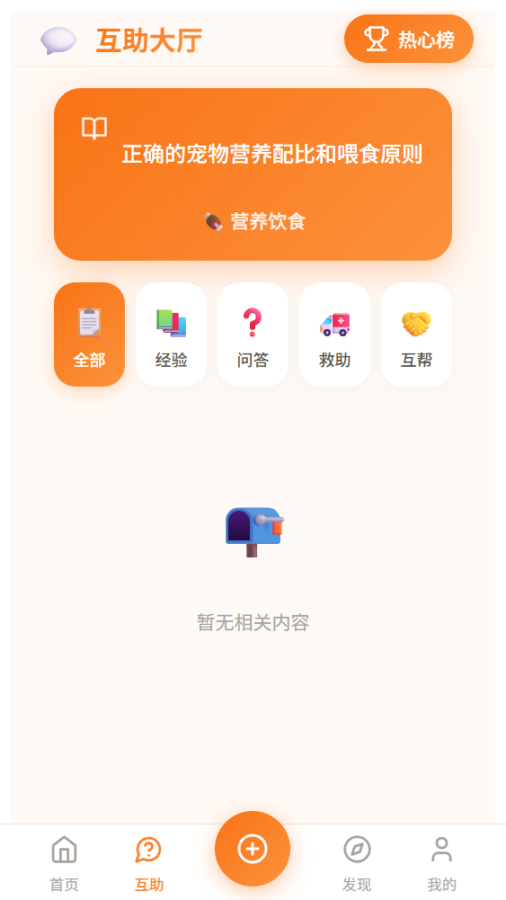
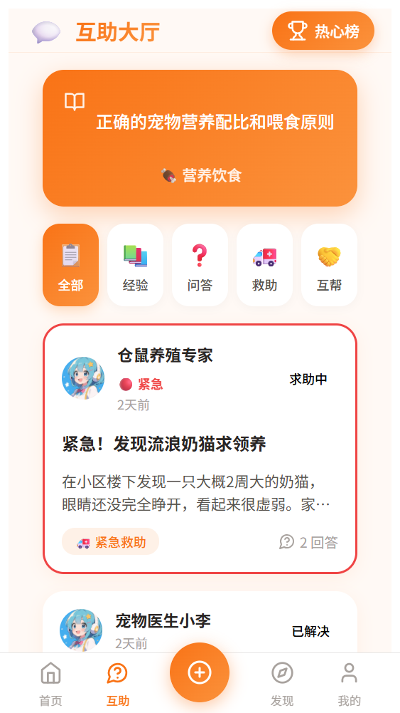
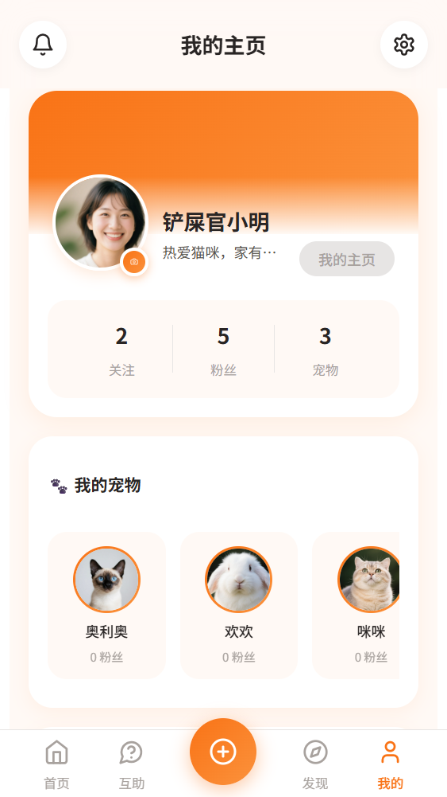

# 🐾 宠友圈 - Pet Circle

一个专为宠物爱好者打造的社交平台，让每一位铲屎官都能记录宠物成长、分享养宠经验、寻求互助帮助。

## 📱 界面预览

### 首页动态流


### 互助大厅


### 发现页


### 个人中心


## ✨ 功能特性

### 📱 核心功能

#### 首页动态流
- 浏览推荐和最新的宠物动态，支持无限滚动加载
- 图文帖子展示，支持多图浏览
- 点赞、评论、分享互动
- 帖子右上角三点菜单支持编辑和删除（仅限自己的帖子）

#### 帖子发布与编辑
- 发布图文帖子，添加心情标签和定位信息
- 支持编辑已发布的帖子
- 支持删除自己的帖子
- 宠物日记功能，记录宠物日常点滴

#### 互助大厅
- 四大分区：经验分享、问答咨询、紧急救助、互助交流
- 发布求助帖子，标记紧急程度
- 回答互助问题，支持采纳最佳答案
- 支持编辑和删除自己的互助帖子和回答

#### 评论系统
- 帖子评论发布与删除
- 防重复提交机制
- 帖子所有者可删除任意评论
- 评论作者可删除自己的评论

#### 私信聊天
- 与其他宠友实时沟通交流
- 消息列表管理
- 在线状态显示

#### 宠物管理
- 创建和管理宠物档案（名字、品种、生日、性别等）
- 宠物主页展示宠物动态
- 多宠物切换管理

### 🔍 社交功能

#### 搜索发现
- 搜索宠物、用户、帖子
- 热门话题推荐
- 发现更多宠友

#### 关注系统
- 关注/取消关注用户和宠物
- 粉丝列表查看
- 关注列表管理

#### 互动通知
- 点赞通知
- 评论通知
- 关注通知
- 未读消息提醒

#### 排行榜
- 热心助人榜
- 热门宠物榜

### 🛠️ 内容管理

#### 编辑功能（参考小红书设计）
- 帖子：右上角三个点菜单 → 编辑
- 求助帖：右上角三个点菜单 → 编辑
- 所有编辑内容真实写入数据库

#### 删除功能
- 帖子删除：三个点菜单 → 删除
- 评论删除：三个点菜单 → 删除评论
- 求助帖删除：三个点菜单 → 删除
- 回答删除：三个点菜单 → 删除回答
- 所有删除操作真实写入数据库

#### 权限控制（RLS 策略）
- 用户只能编辑/删除自己发布的内容
- 帖子所有者可删除评论
- 通过 Supabase RLS 策略在数据库层面强制权限控制

### 🎨 用户体验
- **暖色调设计** - 采用温暖的橙色调，营造温馨友好的氛围
- **骨架屏加载** - 提升加载体验，减少白屏时间
- **图片懒加载** - 优化页面加载性能
- **响应式布局** - 适配各种屏幕尺寸
- **平滑动画** - 流畅的页面切换和交互效果
- **Toast 提示** - 操作反馈即时呈现
- **AI 头像生成** - 统一使用 AI 图片生成服务

## 🛠️ 技术栈

### 前端
| 技术 | 版本 | 说明 |
|------|------|------|
| Vue 3 | 3.5+ | 渐进式 JavaScript 框架 |
| TypeScript | 5.8 | 类型安全的 JavaScript 超集 |
| Vite | 6.3 | 下一代前端构建工具 |
| Pinia | 2.1 | Vue 状态管理库 |
| Vue Router | 4.3 | 官方路由管理器 |
| Vant | 4.8 | 移动端 UI 组件库 |
| Lucide Icons | 0.378 | 图标库 |
| SCSS | 1.77 | CSS 预处理器 |

### 后端（Supabase）
| 服务 | 说明 |
|------|------|
| PostgreSQL | 关系型数据库 |
| Supabase Auth | 用户认证服务（邮箱/密码） |
| Supabase Storage | 图片存储服务 |
| Supabase Realtime | 实时数据同步 |
| RLS 策略 | 行级安全策略，数据库层面权限控制 |

## 📁 项目结构

```
pet-circle/
├── src/
│   ├── components/              # 公共组件
│   │   ├── ActionMenu.vue       # 三点操作菜单（小红书风格）
│   │   ├── TabBar.vue           # 底部导航栏
│   │   ├── PostCard.vue         # 帖子卡片
│   │   ├── LoadingSpinner.vue   # 加载动画
│   │   ├── Toast.vue            # 提示组件
│   │   ├── Dialog.vue           # 对话框组件
│   │   ├── AvatarPicker.vue     # 头像选择器
│   │   ├── DatePicker.vue       # 日期选择器
│   │   ├── LocationPicker.vue   # 定位选择器
│   │   ├── LeaderboardModal.vue # 排行榜弹窗
│   │   ├── PetTipModal.vue      # 宠物提示弹窗
│   │   └── SkeletonCard.vue     # 骨架屏卡片
│   ├── pages/                   # 页面组件
│   │   ├── HomePage.vue         # 首页动态流
│   │   ├── HelpPage.vue         # 互助大厅
│   │   ├── HelpDetailPage.vue   # 互助详情页
│   │   ├── HelpCreatePage.vue   # 发布互助帖
│   │   ├── DiscoverPage.vue     # 发现页
│   │   ├── ProfilePage.vue      # 个人中心
│   │   ├── EditProfilePage.vue  # 编辑资料
│   │   ├── PostDetailPage.vue   # 帖子详情页
│   │   ├── PostCreatePage.vue   # 发布帖子
│   │   ├── DiaryCreatePage.vue  # 发布日记
│   │   ├── LoginPage.vue        # 登录页
│   │   ├── RegisterPage.vue     # 注册页
│   │   ├── MyPetsPage.vue       # 我的宠物
│   │   ├── PetCreatePage.vue    # 创建宠物档案
│   │   ├── PetProfilePage.vue   # 宠物主页
│   │   ├── MessagesPage.vue     # 消息列表
│   │   ├── ChatPage.vue         # 聊天页
│   │   ├── NotificationsPage.vue # 通知页
│   │   ├── FollowersPage.vue    # 关注/粉丝页
│   │   ├── UserPostsPage.vue    # 用户帖子页
│   │   ├── UserProfilePage.vue  # 用户主页
│   │   └── SettingsPage.vue     # 设置页
│   ├── stores/                  # Pinia 状态管理
│   │   ├── userStore.ts         # 用户状态
│   │   ├── feedStore.ts         # 动态流状态
│   │   ├── helpStore.ts         # 互助帖状态
│   │   ├── petStore.ts          # 宠物状态
│   │   └── uiStore.ts           # UI 状态
│   ├── services/                # API 服务层
│   │   ├── authService.ts       # 认证服务
│   │   ├── postService.ts       # 帖子服务
│   │   ├── helpService.ts       # 互助服务
│   │   ├── petService.ts        # 宠物服务
│   │   ├── followService.ts     # 关注服务
│   │   ├── messageService.ts    # 消息服务
│   │   ├── notificationService.ts # 通知服务
│   │   ├── discoverService.ts   # 发现服务
│   │   ├── searchService.ts     # 搜索服务
│   │   ├── userService.ts       # 用户服务
│   │   └── petPawService.ts     # 宠物爪印服务
│   ├── utils/                   # 工具函数
│   │   ├── mappers.ts           # 数据映射
│   │   ├── errorHandler.ts      # 错误处理
│   │   ├── supabaseQuery.ts     # Supabase 查询封装
│   │   └── logger.ts            # 日志工具
│   ├── composables/             # 组合式函数
│   │   └── useAsyncAction.ts    # 异步操作封装
│   ├── supabase/                # Supabase 配置
│   │   └── supabaseClient.ts    # 客户端实例
│   ├── theme/                   # 主题配置
│   │   └── tokens.scss          # 设计令牌
│   └── router/                  # 路由配置
│       └── index.ts             # 路由表
├── supabase/
│   └── init/                    # SQL 初始化脚本
│       ├── 001_init_extensions.sql  # 扩展初始化
│       ├── 002_enums.sql            # 枚举类型
│       ├── 003_tables.sql           # 数据表
│       ├── 004_triggers.sql         # 触发器
│       ├── 004_pet_paws.sql         # 宠物爪印
│       ├── 005_indexes.sql          # 索引
│       ├── 006_rls_policies.sql     # RLS 安全策略
│       ├── 007_fix_triggers.sql     # 触发器修复
│       ├── 008_fix_help_posts.sql   # 互助帖修复
│       └── 009_fix_auth_triggers.sql # 认证触发器修复
├── docs/
│   └── screenshots/             # 项目截图
├── .env.example                 # 环境变量示例
└── package.json                 # 项目配置
```

## 🚀 快速开始

### 环境要求
- Node.js >= 18.0
- npm >= 9.0
- Supabase 账户（用于后端服务）

### 1. 克隆项目

```bash
git clone https://github.com/liming600/gleaming-moonbeam-83da38.git
cd gleaming-moonbeam-83da38
```

### 2. 安装依赖

```bash
npm install
```

### 3. 配置环境变量

创建 `.env` 文件：

```env
VITE_SUPABASE_URL=your-supabase-project-url
VITE_SUPABASE_ANON_KEY=your-supabase-anon-key
```

### 4. 初始化数据库

在 Supabase 控制台的 SQL 编辑器中，按顺序执行 `supabase/init/` 目录下的所有 SQL 文件。

### 5. 启动开发服务器

```bash
npm run dev
```

### 6. 构建生产版本

```bash
npm run build
```

## 📊 数据库结构

### 核心数据表

| 表名 | 说明 | 主要字段 |
|------|------|----------|
| users | 用户信息 | id, username, avatar, bio |
| pets | 宠物档案 | id, owner_id, name, species, breed, birthday |
| posts | 帖子 | id, pet_id, content, images, tags, location |
| comments | 评论 | id, post_id, user_id, content |
| likes | 点赞 | id, post_id, user_id |
| help_posts | 互助帖子 | id, author_id, zone, title, content, status, is_urgent |
| help_answers | 互助回答 | id, post_id, author_id, content, is_accepted |
| follows | 关注关系 | id, follower_id, followee_id |
| messages | 私信消息 | id, sender_id, receiver_id, content |
| notifications | 通知 | id, user_id, type, content, is_read |
| pet_paws | 宠物爪印 | id, pet_id, giver_id |

### RLS 安全策略

项目使用 Supabase 的行级安全（RLS）策略保护数据：
- 用户只能修改/删除自己发布的内容
- 帖子所有者可以删除评论
- 关注关系只能由本人操作
- 私信只有发送者和接收者可见

## 📱 页面一览

| 页面 | 路由 | 说明 |
|------|------|------|
| 首页 | `/` | 动态流，浏览帖子 |
| 互助大厅 | `/help` | 互助帖子列表 |
| 发现 | `/discover` | 搜索和发现 |
| 个人中心 | `/profile` | 个人主页 |
| 帖子详情 | `/post/:id` | 帖子详情和评论 |
| 互助详情 | `/help/:id` | 互助帖详情和回答 |
| 发布帖子 | `/post-create` | 创建/编辑帖子 |
| 发布互助 | `/help-create` | 创建/编辑互助帖 |
| 消息 | `/messages` | 私信列表 |
| 聊天 | `/chat/:id` | 与用户聊天 |
| 通知 | `/notifications` | 通知列表 |
| 我的宠物 | `/my-pets` | 宠物管理 |
| 设置 | `/settings` | 应用设置 |

## 📄 许可证

MIT License

## 🤝 贡献

欢迎提交 Issue 和 Pull Request！

---

**🐾 用爱陪伴，用心记录**
